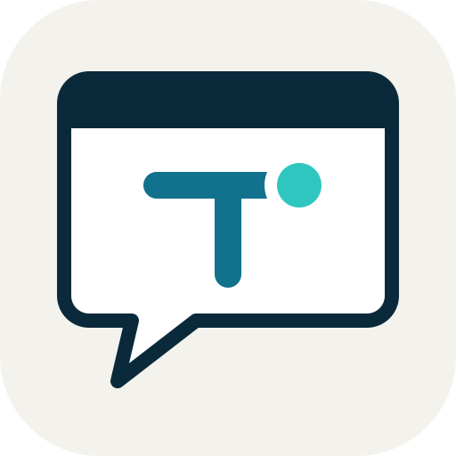
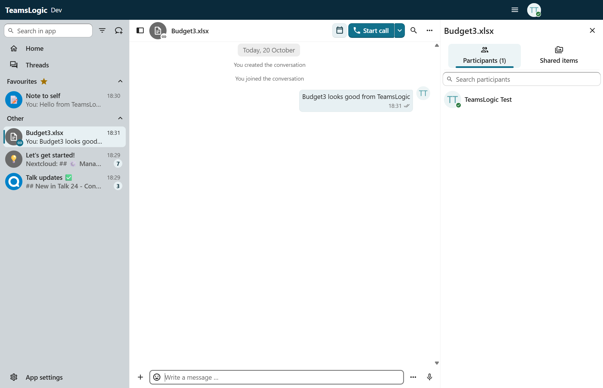

<!--
  - SPDX-FileCopyrightText: 2026 Aegean Logic
  - SPDX-FileCopyrightText: 2022 Nextcloud GmbH and Nextcloud contributors
  - SPDX-License-Identifier: AGPL-3.0-or-later
-->

<p align="center"></p>

<h1 align="center">TeamsLogic</h1>

<p align="center">
  <b>Chat, calls and meetings for Aegean Office, on your own Nextcloud.</b><br>
  <i>By <a href="https://www.aegeanlogic.co.uk">Aegean Logic</a>. Based on
  <a href="https://github.com/nextcloud/talk-desktop">Nextcloud Talk Desktop</a>.</i>
</p>

<p align="center"></p>

TeamsLogic is the Teams-style app of Aegean Office, next to GridLogic, WordLogic and SlideLogic.
It is a fork of Nextcloud Talk Desktop: one-to-one and group chat, calls with screen sharing,
the conversation of each shared file, and notifications, against the Talk app on your Nextcloud.

- **Server:** Nextcloud 27 or later with Talk 17 or later, over `https://` only (Talk Desktop
  has no `http://` support). Checked against Nextcloud 34.0.5 with Talk 24.0.6.
- **Built-in Talk:** the Talk web front end it carries is v25.0.6 (from `@nextcloud/talk`).

## What the fork changes

The rebrand uses Talk Desktop's own branding hook, so upstream merges stay cheap:

| Where | What |
|---|---|
| `.overrides/build.config.json` | The name, description, app id `uk.co.aegeanlogic.teamslogic`, company Aegean Logic, copyright, Aegean colours (primary sea `#12718C`, background ink `#0A2A3B`) |
| `.overrides/styles/35/` | Nextcloud 35 styles themed with those colours (`node scripts/override-nextcloud-styles.mjs --version 35`, needs Docker) |
| `brand/` | The icon masters, "Bubble trace" (`teamslogic.svg`, and `teamslogic-small.svg` for 32 px and below) |
| `img/` | Every image derived from them, under upstream's file names: `npm run generate-branding` (`scripts/teamslogic-branding.cjs`) |
| `build/resolveBuildConfig.js` | A branded config may set `companyName` and `copyright`; the MSI UpgradeCode comes from `winAppId`, so TeamsLogic (`197f49ff-ed4b-5364-a6ee-7864cad64cbb`) never upgrades over Nextcloud Talk (`1436ac6d-…`) |
| `package.json` | `productName`, `desktopName`, and the repository and issue links (Aegean-Logic/teamslogic) |
| About box, Help menu, main menu | Keep the Source Code and Issues links in branded builds (the AGPL source offer) and credit Aegean Logic and Nextcloud Talk Desktop |

Internal names stay upstream's: the npm package `talk-desktop`, the l10n app id `talk_desktop`,
the window entry points `talk_desktop__window_*`, `window.TALK_DESKTOP`, and the img file names.

Branded builds turn off upstream's GitHub update check (it would look at Nextcloud's releases).
TeamsLogic updates come with Aegean Office Setup.

## Building on Windows

Needs Node 24 and npm 11.

```bash
npm ci
npm run build:windows:x64
npm run package:windows:x64:exe
```

`out/TeamsLogic-win32-x64/TeamsLogic.exe` is the app; `out/make/squirrel.windows/x64/TeamsLogic-windows-x64.exe`
is the per-user Setup. The machine-wide MSI (`npm run package:windows:x64:msi`) needs WiX
Toolset v3.14 (`candle.exe` and `light.exe` on `PATH`), which electron-wix-msi uses.

`npm run dev` runs it from source as "TeamsLogic (dev)", with its own settings folder.

After changing an icon master, run `npm run generate-branding`. After changing the colours in
`.overrides/build.config.json`, or when the built-in Talk moves to a new Nextcloud version,
regenerate the styles with `node scripts/override-nextcloud-styles.mjs --version <major>`; the
build stops with a message saying so when they're out of date.

### Against a local Nextcloud on http://

Talk Desktop only signs in over `https://`. For a test Nextcloud on `http://localhost:8080`
(Docker), put Caddy in front on loopback and trust it as a proxy:

```bash
docker run -d --name teamslogic-https --network nextcloud_default -p 127.0.0.1:8443:443 caddy:2 caddy reverse-proxy --from localhost --to nextcloud-app-1:80 --internal-certs
docker exec -u www-data nextcloud-app-1 php occ config:system:set trusted_proxies 0 --value=172.24.0.0/16
```

Sign in to `https://localhost:8443` and accept Caddy's certificate in TeamsLogic's warning
(Advanced, Proceed). A file gets a conversation once it is shared (Talk 24 also counts a link share).

## Merging upstream

```bash
git fetch upstream --tags
git merge v2.x.y
```

Conflicts are most likely in the derived images (take upstream's, then `npm run generate-branding`),
`package.json`, `REUSE.toml` and the handful of files above. Then rebuild, and regenerate the styles
if the build asks for it.

## Plan: TeamsLogic in Aegean Office Setup

Aegean Office Setup (`installer/windows/` in the head repo) is a WiX v5 Burn bundle chaining
the apps' MSIs. TeamsLogic joins it as a fourth package:

1. **TeamsLogic's MSI.** Talk Desktop already makes a per-machine MSI with electron-wix-msi: it
   installs to Program Files, adds a Start menu shortcut and the firewall exception calls need,
   and shows in Installed apps. With the branding above it is TeamsLogic by Aegean Logic, with its
   own UpgradeCode. It is built with WiX v3; a WiX v5 bundle chains any MSI, so only the build
   machine needs WiX v3.14 as well as v5.
2. **Desktop shortcut.** The other three MSIs take `DESKTOPSHORTCUT=1|0`. Add the same to
   TeamsLogic's MSI in `forge.config.js`, in the `beforeCreate` hook that already edits the
   generated `.wxs` for the firewall: a `DESKTOPSHORTCUT` property (default 0) and a component
   with a desktop shortcut under that condition.
3. **`build.ps1`.** Build TeamsLogic after the other three: `npm ci`, `npm run build:windows:x64`,
   `npm run package:windows:x64:msi` in `teamslogic/`, then pass the MSI to WiX as
   `-d TeamsLogicMsi=…`. `-SkipApps` reuses it like the others.
4. **`bundle.wxs`.** A fourth `<MsiPackage Id="TeamsLogic">` in the chain with
   `DESKTOPSHORTCUT=[DesktopShortcuts]`, and a `teamslogic.png` payload. The bundle's UpgradeCode
   stays, so the next Setup adds TeamsLogic to machines that have the suite already.
5. **The Setup window.** `theme.xml` and `theme.wxl` list four apps; `branding/generate.ps1`
   renders `teamslogic.png` from `brand/teamslogic/teamslogic.svg` (once the icon is final, its
   masters go into the head repo's `brand/teamslogic/`).
6. **Signing.** `forge.config.js` signs the exe and the MSI when `WINDOWS_SIGN_PARAMS` is set,
   which will carry the Azure Artifact Signing parameters once that account is validated.
7. **Head repo.** `teamslogic` becomes the seventh submodule (Aegean-Logic/teamslogic), and the
   README and the installer's README say four apps.

## Plan: opening shared Office files in Aegean Office

Today a spreadsheet, document or presentation shared in a chat opens in the browser: Talk calls
`OCA.Viewer` for a file it can preview, and TeamsLogic's Viewer (`src/talk/renderer/Viewer/`)
has handlers only for images, video, audio, PDF and text, so other files open their Nextcloud
link externally. The plan:

1. **A Viewer handler for Office files.** Register a handler for the `.xlsx`, `.docx` and `.pptx`
   MIME types (and ODF where an app reads it) that doesn't render the file. It sends the main
   process the file's `path` (the message's file parameter, relative to this user's files) and
   this account's server address.
2. **Open it in the app.** The main process builds the link the browser editors already use,
   `gridlogic://open?server=…&path=…` (or `wordlogic://`, `slidelogic://`), and opens it with
   `shell.openExternal` after checking the scheme is one of the three and
   `app.getApplicationNameForProtocol()` finds the app. The desktop app signs in to that Nextcloud
   if it isn't yet, and joins the file's live co-editing session.
3. **Fallback.** If the app isn't installed, open the browser editor
   (`/apps/gridcraft/edit?path=…`, `/apps/wordcraft/edit?…`, `/apps/deckcraft/edit?…`) through the
   existing external-link handler.
4. **Choice.** The file's menu gets "Open in GridLogic" and "Open in browser", and App settings
   gets "Open Office files in: Aegean Office apps / the browser".
5. **The other way round.** The desktop apps' "Chat about this file" opens the file's room in the
   browser today. Give TeamsLogic a `teamslogic://` scheme (`teamslogic://call/<token>?server=…`,
   registered by its installer) and have the apps prefer it when it is installed.

## Licence

AGPL-3.0-or-later, like Nextcloud Talk Desktop: see [LICENSE](LICENSE) and `LICENSES/`. The
TeamsLogic icon and the images made from it are original work in the Aegean Logic palette,
MIT OR Apache-2.0 (see `REUSE.toml`). Nextcloud and Talk are trademarks of Nextcloud GmbH, and
the Aegean Logic name is a trademark of Aegean Logic.
